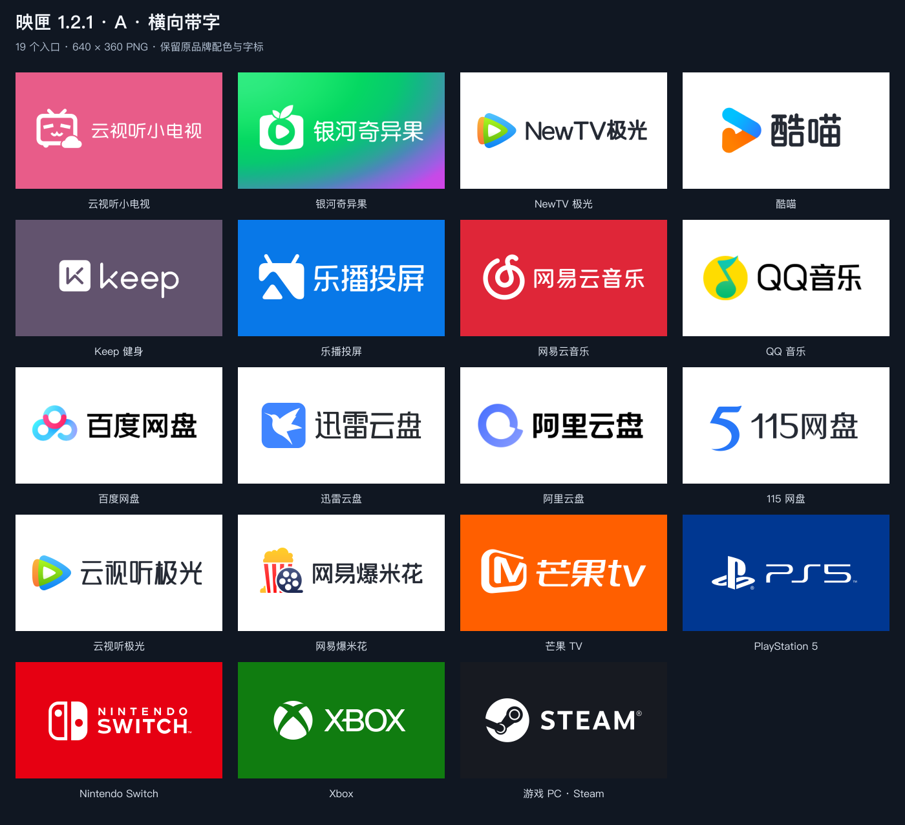
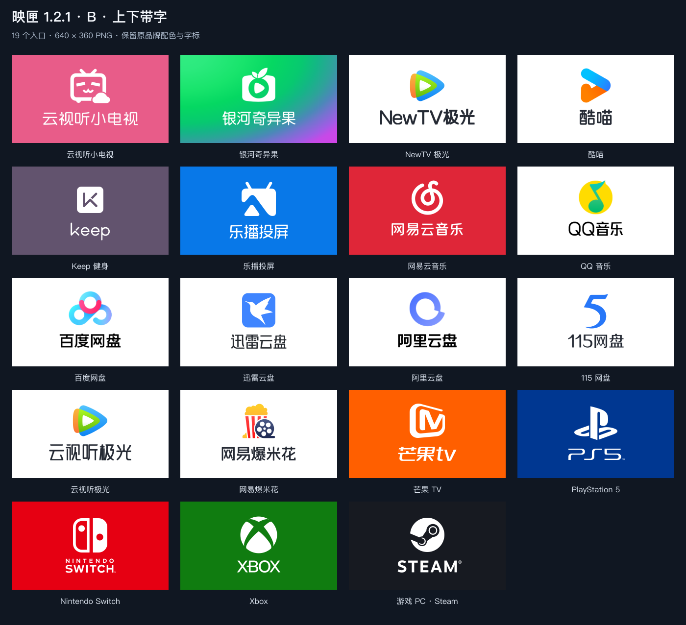
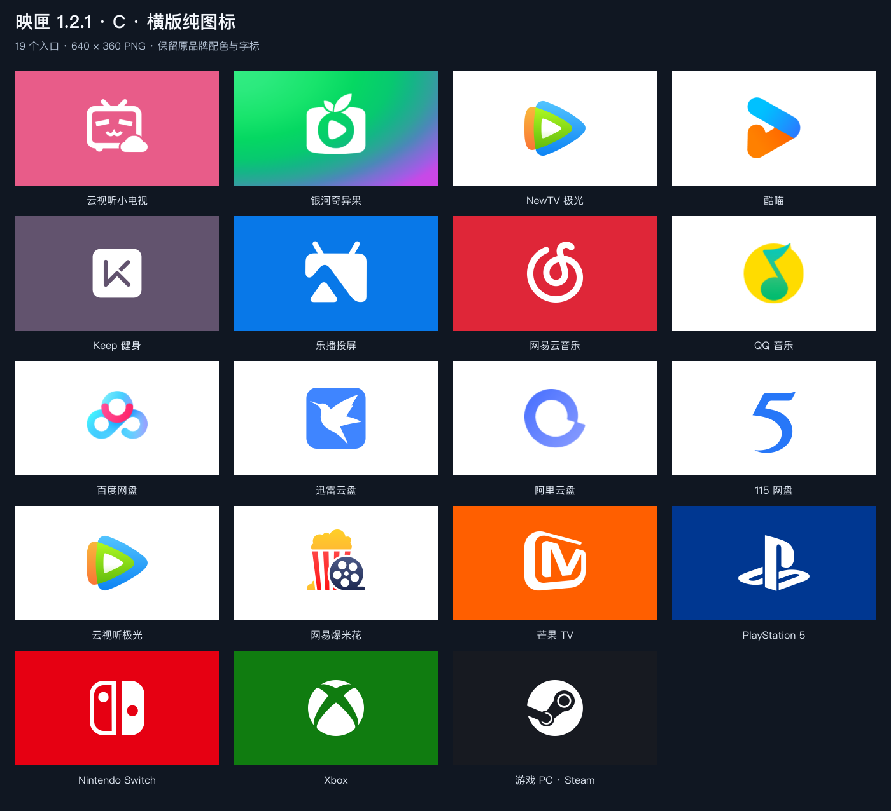
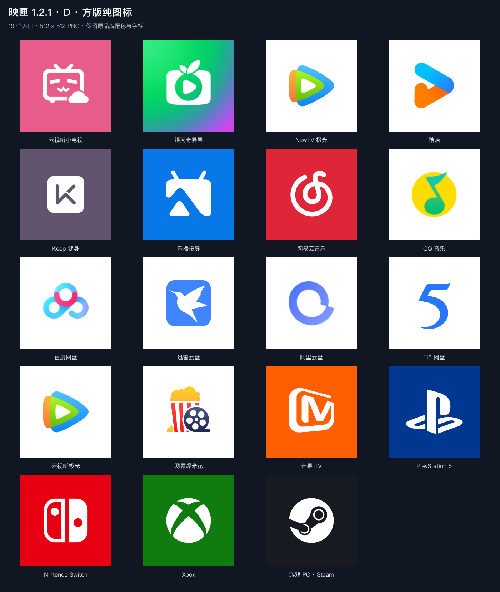

# 映匣 · CineDock

给电视上的应用和 HDMI 输入源换一套清晰、协调、容易辨认的图标。

CineDock 是为 [Projectivy Launcher](https://github.com/spocky/miproja1) 制作的 Android 图标包。包含 **15 个应用、4 个游戏设备、4 种样式，共 76 张 PNG**，可通过遥控器浏览、预览和选择。

[CC BY-NC-SA 4.0](LICENSE) · [许可范围与第三方素材](NOTICE.md)

## 设计与功能

- 保留熟悉的品牌配色与原字标：适合白底的应用使用白底和彩色标志，不强行统一成彩底白标。
- 横向卡片铺满背景，解决方形应用图标在横向卡片中两侧留空的问题。
- 字标在电视上清晰可读：上下带字使用固定的图标行和文字行，图形与字标按视觉重心而不是外框对齐，并逐张校正偏高、偏低或偏右的卡片。
- 图片更新时自动换用带版本号的新名称，Projectivy 不会继续显示旧缓存。
- 提供横向带字、上下带字、横版纯图标和方版纯图标。
- 已知应用可自动匹配；HDMI 和未匹配的应用可以手动指定。
- 图片内置于 APK，安装后无需继续插着 U 盘或 SD 卡。
- 原生 Android 界面，无广告，不申请联网、存储或其他 Android 权限。

### 图标清单

| 类别 | 包含入口 |
| --- | --- |
| 影音 | 云视听小电视、银河奇异果、NewTV 极光、云视听极光、酷喵、芒果 TV、网易爆米花 |
| 音乐 | 网易云音乐、QQ 音乐 |
| 网盘 | 百度网盘、迅雷云盘、阿里云盘、115 网盘 |
| 其他 | Keep、乐播投屏 |
| HDMI 设备 | PlayStation 5、Nintendo Switch、Xbox、游戏 PC / Steam |

### 四种样式

| 文件名前缀 | 样式 | 尺寸 |
| --- | --- | --- |
| `a_` | 横向带字：标志在左，字标在右 | 640 × 360 |
| `b_` | 上下带字：标志在上，字标在下 | 640 × 360 |
| `c_` | 横版纯图标：标志居中 | 640 × 360 |
| `d_` | 方版纯图标：标志居中 | 512 × 512 |


### 四种样式预览

每张预览包含全部 19 个入口，来自 APK 中实际使用的图片。点击图片可查看原尺寸预览。

**A · 横向带字**

[](docs/preview.png)

**B · 上下带字**

[](docs/preview-stacked.png)

**C · 横版纯图标**

[](docs/preview-icon-only.png)

**D · 方版纯图标**

[](docs/preview-square.png)

## 安装与使用

图标包支持 Android 5.0 及以上。自定义卡片图标需使用支持该功能的 **Projectivy Premium**；其他启动器的兼容性未验证。

1. 按下文构建，取得 `dist/CineDock-1.2.1.apk`。
2. 通过 U 盘、SD 卡、局域网文件传输或 ADB 将 APK 放到电视上，用文件管理器打开安装。若系统提示，允许该文件管理器安装应用。
3. 打开 Projectivy，先完成下方的关闭着色设置，再选择图标。

安装图片或图标包不需要刷机。同一签名的新版本可以覆盖安装。图片有更新的图标会换成带版本号的新名称（例如 `a_keep_v1_2_1`），Projectivy 因此不会继续显示旧缓存；更新后请为这些卡片重新选择一次图标，批量应用的在图标包设置中重新应用即可。内容没变的图标保持原名，已选好的不受影响。

### 必设：关闭图标着色

**首次使用、换电视、重置 Projectivy 或更换主题后，请检查这两处：**

1. **Projectivy 设置 → 外观 → 卡片 → 自定义图标着色（Custom icon tint）**：在色板的颜色方块末尾选 **×** 取消着色，再确定。
2. **同页 → 聚焦卡片（Focused card）→ 颜色覆盖模式**：设为 **无／不覆盖（None）**。

这套图标包含完整背景。额外着色会同时覆盖标志、文字和背景，使整张卡片变成一块纯色，看起来像图标消失了。关闭着色后即可保留图片原色。通过“从图片”单独选入 PNG 时也适用。

这一问题及解决方法已在索尼 X95EL 上得到使用者确认；映匣应用内的“使用指南”也保留了相同步骤。

### 单独选择

长按应用或 HDMI 卡片 → **更改图标 → 图标包 → 映匣 · CineDock**。

Projectivy 4.72 的内置浏览器直接列出全部图片，不会显示映匣自己的四个样式按钮。按 `a_` / `b_` / `c_` / `d_` 区分样式，名称末尾的 `_v1_2_0`、`_v1_2_1` 表示该图在对应版本更新过；设备图标的名称含 `ps5`、`nintendo_switch`、`xbox`、`gaming_pc_steam`。

直接打开映匣应用可以预览四种样式；预览本身不会修改 Projectivy 的卡片。

### 批量应用

**Projectivy 设置 → 外观 → 卡片 → 图标包 → 映匣 · CineDock**。

自动匹配默认使用横向带字版。匹配依赖应用包名，厂商定制版或第三方客户端可能需要手动选择。四个 HDMI 入口请分别指定设备，图标包不会假定某个 HDMI 编号对应哪台主机。菜单名称可能随版本和语言略有差异。

## 构建 APK

当前构建脚本针对 **macOS**，需要 **Python 3.9+ 和 JDK 17+**。无需 Android Studio 或 Gradle。Windows / Linux 尚未适配。

```sh
python3 tools/build.py
python3 tools/verify_bundle.py
```

首次构建会从 Google 下载固定版本的 Android SDK Build Tools 35 和 API 35 平台文件，校验摘要后放入 `.toolchain/`。Android SDK 遵循其自身许可。APK 输出到 `dist/`，文件名自动取自 Manifest 的版本号。

Java 按 `CINEDOCK_JAVA_HOME`、`JAVA_HOME` 的顺序选择；未配置时尝试 Apple Silicon Homebrew 的 JDK 17 路径，再使用 `PATH`。已有工具链可通过 `CINEDOCK_TOOLCHAIN` 指定，目录结构应为：

```text
<toolchain>/
├── build-tools/android-15/
└── platform/android-35/android.jar
```

### 本地签名

首次构建在 `.signing/` 创建本地签名密钥和密码文件，后续构建复用同一密钥。该目录及常见签名文件已加入 `.gitignore`。

请自行备份签名文件；移动维护者的实际工程时保留 `.signing/`。从公开源码全新构建会使用另一把签名，不能覆盖安装由原维护者签名的 APK。签名私钥和密码不应放入仓库或发布附件。

## 修改图片与新增图标

完整的 76 张成品 PNG 已在 `app/src/main/res/drawable-nodpi/` 中，普通 APK 构建不需要 Node.js。

### 重新渲染卡片

应用图形与字标在 `artwork/color-sources/`，游戏设备的矢量符号与字标在 `artwork/hdmi-sources/`，每张卡片的可编辑排版在 `artwork/brand-layouts/`。渲染脚本使用原图形与字标，不用通用字体重新输入应用名称。字号、间距和背景色集中在 `tools/render_cards.cjs` 开头的布局表和条目表中：横向带字按各自的框适配大小；上下带字使用固定高度的图标行和文字行，每张卡片的两行位置一致。图形与字标都按墨迹重心而不是外框对齐中线，带叶子、天线等突出部分的图形不会显得偏低。渲染时还会测量整张卡片的视觉重心：竖版偏下的略微上提，横版偏右（多为白底黑字）的略微左移，每张调整了多少会在运行结果里列出。个别卡片按目视做的手动微调写在条目表的 `tweak`（位置）和 `wordScale` / `iconScale`（大小）中，在自动平衡之后叠加。

需要 Node.js 20.9+：

```sh
npm ci
npm run render:cards
python3 tools/build.py
python3 tools/verify_bundle.py
```

脚本按原素材重新渲染全部 76 张图片。像素没有变化的图片保持原名、不改写；有变化的图片改名为 `<样式>_<key>_v<版本号>`，并同步更新 `catalog.xml`、`drawable.xml`、`appfilter.xml`（含 `assets/` 副本）、`icon_pack.xml` 和 `artwork/catalog.json` 中的引用。因此请先在 `package.json` 与 `AndroidManifest.xml` 中升级版本号，再运行渲染。`package-lock.json` 固定图片处理工具的依赖版本。

更新卡片图片后，运行 `npm run render:previews`，即可重新生成 README 中四种样式的完整预览。预览说明文字使用系统的中文字体；卡片内的品牌字形仍来自图片素材。

### 增加入口

1. 在 `tools/render_cards.cjs` 的条目表中加入素材并运行 `npm run render:cards`，生成 `a_<key>`、`b_<key>`、`c_<key>`、`d_<key>` 四张 PNG；也可以直接放入按此命名的自制 PNG。
2. 更新 `res/xml/catalog.xml`（`a`–`d` 属性写明四种样式的资源名）、`res/xml/drawable.xml`、`res/values/icon_pack.xml` 和 `artwork/catalog.json`。
3. 更新 `appfilter.xml`：自动匹配条目使用默认横向版；所有样式还需加入不带 `component` 的手动选择条目。
4. 同步 `res/xml/` 和 `assets/` 下的 `appfilter.xml`、`drawable.xml`，并记录素材来源及包名映射。
5. 更新界面的入口数量、`tools/verify_bundle.py` 和 `tests/ProbeActivity.java` 中的预期数量，然后重新构建检查。

Projectivy 4.72 的内置选图器读取 `appfilter.xml`，仅更新 `drawable.xml` 会导致手动列表漏项。升级时不要手动改名，交给渲染脚本按上面的规则处理。

## 项目结构

```text
app/src/main/
├── java/                         # 电视界面、图标目录、只读图片接口
├── res/drawable-nodpi/            # 76 张图标及应用自身标志
├── res/xml/                      # 图标目录与应用匹配
└── assets/                       # 图标包兼容目录
artwork/
├── catalog.json                  # 入口与仓库内图片路径
├── app-mappings.json             # 已知应用包名与组件
├── color-sources/                # 应用的原图形和字标
├── hdmi-sources/                 # 游戏设备的矢量符号和字标
├── brand-layouts/                # 76 张卡片的 SVG 排版
└── *SOURCES.txt                  # 第三方素材来源与处理记录
docs/preview*.png                 # 四种样式的完整预览
tools/                            # 构建、资源检查、卡片渲染
tests/                            # 独立 Android 兼容性检查应用
```

采用 ADW / Nova 图标包发现接口、原尺寸图标资源返回值和只读 PNG URI，不依赖 Candybar 或 Blueprint 运行库。

## 验证

构建过程校验 APK 签名与对齐。`tools/verify_bundle.py` 检查图片数量、尺寸、不透明 RGB 格式、手动目录、自动映射，以及 APK 内图片资源；还会核对资源名是否符合 `<样式>_<key>[_v<版本号>]` 的规则、版本后缀不超过当前版本、没有遗留的旧图，以及 `package.json` 与 Manifest 的版本一致。

独立测试应用验证主题发现、全部 76 张图片的跨应用读取与绘制、只读限制，以及选图结果返回。它不包含在正式 APK 中：

```sh
python3 tools/build_probe.py
adb -s <测试设备序列号> install -r dist/CineDock-1.2.1.apk
adb -s <测试设备序列号> install -r build/probe/probe.apk
adb -s <测试设备序列号> shell am start -n com.redwinam.cinedock.probe/.ProbeActivity
```

选择一张图标后，屏幕会显示结果，也可读取：

```sh
adb -s <测试设备序列号> shell run-as com.redwinam.cinedock.probe cat files/result.json
```

本地检查覆盖 Android 图标包接口；Projectivy Premium 在索尼电视上的正常显示由使用者确认，未进行跨品牌电视的全面验证。

## 版本记录

- **1.2.1**：Keep 改用官方的白色圆角徽标；NewTV 极光、云视听极光的字标加粗放大，图标略缩小让出空间。
- **1.2.0**：字标放大；上下带字改为固定的图标行和文字行；图形与字标按视觉重心对齐并逐张微调，游戏设备字标末尾的 ™ / ® 不计入居中；银河奇异果改用现行奇异果TV图标的绿—青—紫渐变；有变化的图片改用带版本号的新名称，避免 Projectivy 显示旧缓存；全部卡片可由仓库内素材重新渲染。
- **1.1.0**：九个应用恢复白底、彩色标志和深色字标；加入关闭着色的使用说明与首页提醒。
- **1.0.1**：修复 Projectivy 内置列表只显示默认应用图、缺少其他样式及 HDMI 图标的问题。
- **1.0.0**：首版，提供 19 个入口、四种样式和遥控器选图界面。

## 素材与许可

本项目为个人电视界面定制项目，与 Sony、Projectivy 及图标涉及的品牌无隶属或合作关系。

Copyright © 2026 Redwinam.

本项目采用 **[CC BY-NC-SA 4.0（署名—非商业性使用—相同方式共享 4.0 国际）](https://creativecommons.org/licenses/by-nc-sa/4.0/)**，适用于维护者拥有并有权许可的原创代码、文档、排版及创作部分。完整条款见 [LICENSE](LICENSE)，具体适用范围见 [NOTICE.md](NOTICE.md)。

使用这些受许可内容时，应保留署名及许可信息，说明修改，并遵守非商业性使用和相同方式共享的条款。建议署名为 **映匣 · CineDock — Redwinam**，附上 [项目链接](https://github.com/Redwinam/cinedock)。

第三方品牌名称、商标、标志及字标仍属于各自权利人，不因本仓库的许可而重新授权。CC0、公有领域或采用其他许可的原素材继续保持其原有状态；第三方软件依赖遵循各自许可。素材来源与处理记录见 [应用素材来源](artwork/APPLICATION_SOURCES.txt) 和 [游戏设备素材来源](artwork/HDMI_SOURCES.txt)。

相关兼容性参考：[Projectivy 4.72 内置选图器](https://github.com/spocky/miproja1/releases/tag/4.72)、[Blueprint](https://github.com/jahirfiquitiva/Blueprint)、[Candybar 原尺寸资源返回说明](https://github.com/zixpo/candybar/pull/202)。
